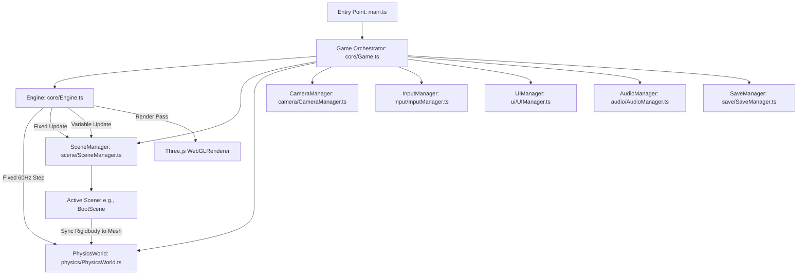

# FUR & FURY — Architectural Blueprint & System Design

> **"Adorable by Nature. Dangerous by Destiny."**  
> *Official Product Requirements Document (PRD) v1.0 Alignment*

---

## 1. Executive System Overview

**FUR & FURY** is built as a high-performance 3D third-person fantasy action-adventure browser game. The client architecture is designed to deliver AAA-inspired visual cohesion, deterministic physics simulation, and fluid swordplay without reliance on monolithic files or unverified external assets.

### Technology Stack
- **Engine & Renderer:** Three.js (r174) with PBR materials, ACESFilmic tone mapping, and PCF soft shadow maps.
- **Physics Engine:** Rapier 3D via `@dimforge/rapier3d-compat` (WebAssembly-based 60Hz deterministic rigid body simulation).
- **Language & Tooling:** TypeScript (strict mode ES2022) + Vite 6 + Vitest.
- **Interface & UX:** HTML5 / CSS3 with hardware-accelerated glassmorphism and modern display typography.
- **Audio:** Web Audio API with procedural audio fallbacks and gain bus trees.

---

## 2. Layered Architecture

---

## 3. Subsystem Breakdown

### 3.1 Game Loop & Time System (`src/core/Engine.ts`, `src/core/Time.ts`)
- **Fixed Timestep:** Physics simulation steps at an invariant 60Hz (`fixedDeltaTime = 1 / 60s`).
- **Accumulator Clamping:** Uses a maximum sub-step budget (`maxSubSteps = 4`) to prevent spiral-of-death slowdowns during frame drops.
- **Render Interpolation:** Meshes query instantaneous rigid body positions/quaternions during `fixedUpdate`.
- **Clamped Variable Delta:** `deltaTime` is clamped to 100ms maximum to prevent extreme simulation jumps on tab refocus.

### 3.2 Physics System (`src/physics/PhysicsWorld.ts`)
- Wraps `@dimforge/rapier3d-compat` asynchronous WASM initialization.
- Exposes typed factory methods for:
  - Static colliders (arena floors, stairs, pillars, architecture).
  - Dynamic rigid bodies (projectiles, physics test emblems, interactive props).
  - Kinematic character controller integration (planned for Step 3).

### 3.3 Scene Management (`src/scene/SceneManager.ts`, `src/scene/IScene.ts`)
- Enforces explicit scene lifecycle:
  - `init(context)`: Asynchronous asset loading and scene graph population.
  - `update(deltaTime)`: Variable time animations, audio, and camera tracking.
  - `fixedUpdate(fixedDeltaTime)`: Physics synchronizations and combat raycasts.
  - `destroy()`: Complete disposal of Three.js geometry, material buffers, and rigid bodies.

### 3.4 Input System (`src/input/InputManager.ts`)
- Supports keydown, keyup, and single-frame `justPressed` triggers.
- Rebindable action mappings according to PRD Section 9:
  - Move: `WASD` / Arrow Keys
  - Dodge: `Space`
  - Light Attack: `J` / Left Click
  - Heavy Attack: `K` / Right Click
  - Parry: `Q` / `F`
  - Guard: `Shift` / `E`
  - Lock-on: `R` / Middle Click
  - Dragon Call: `T` / `X`

### 3.5 Persistence & Save Schema (`src/save/SaveManager.ts`)
- Strict JSON schema tracking:
  - `oathSeals`: Array of defeated human champions (Garrick, Elowen, Brannoc, etc.).
  - `upgrades`: Levels for Swift Paw, Silver Claw, Dragonheart branches.
  - `currentCheckpoint`: Active region and 3D spawn coordinates.
  - `dialogueFlags`: Narrative relationship tracking with human rivals.

---

## 4. 10-Step Milestone Roadmap

| Step | Milestone Name | Status | Deliverables |
| :--- | :--- | :---: | :--- |
| **Step 1** | **Project Foundation & Game Architecture** | **COMPLETED** | Vite + TS + Rapier 3D + Three.js loop, BootScene, UI HUD, unit tests |
| Step 2 | 3D World & Medieval Environment | Pending Approval | Grand Arena architecture, PBR shaders, limestone textures, braziers |
| Step 3 | Anuki Character & Third-Person Controller | Pending Approval | Anuki mesh/rig, third-person follow cam, kinematic move/dodge |
| Step 4 | Rhazakar Dragon & Opening Cinematic | Pending Approval | Dragon arrival, animated sequence, arena landing |
| Step 5 | Sword Combat & Player Abilities | Pending Approval | Moonfang swordplay, combos, parry/guard, stamina bar, poise |
| Step 6 | Human Knight Enemies & Intelligent AI | Pending Approval | Sir Garrick Ironjaw AI, telegraphs, halberd swings, punish windows |
| Step 7 | Level Progression & Boss Battles | Pending Approval | Multi-phase duels, Oath Seal acquisition, yield/defeat sequences |
| Step 8 | Storytelling, Dialogue & Interactive Systems | Pending Approval | Interactive NPCs, dialogue box with choices, lore codex |
| Step 9 | UI/UX, Audio, Visual Effects & Polish | Pending Approval | Full HUD, particle sparks, hit-stop, camera shake, sound design |
| Step 10 | Optimization, Testing & Final Deployment | Pending Approval | Asset bundling, 60 FPS profiling, regression test pass, release candidate |

---

## 5. Verification & Acceptance Criteria
- Zero unresolved TypeScript diagnostics (`tsc --noEmit`).
- Automated tests passing via `vitest run`.
- Production bundle successfully generated via `vite build`.
- 60 FPS verified with Three.js ACES Filmic tonemapping and Rapier 3D WASM physics.
